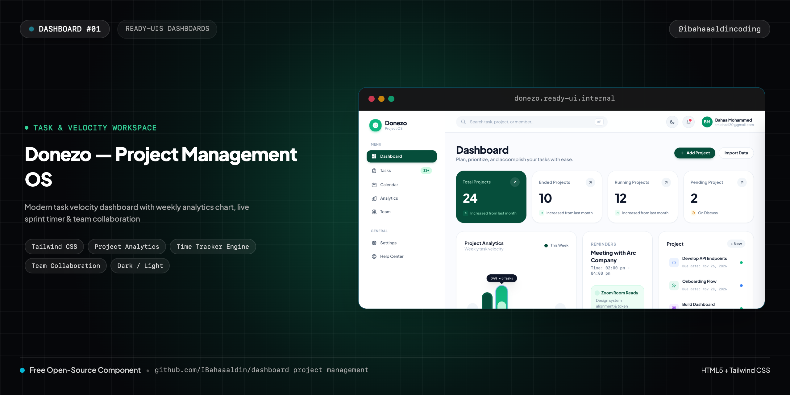
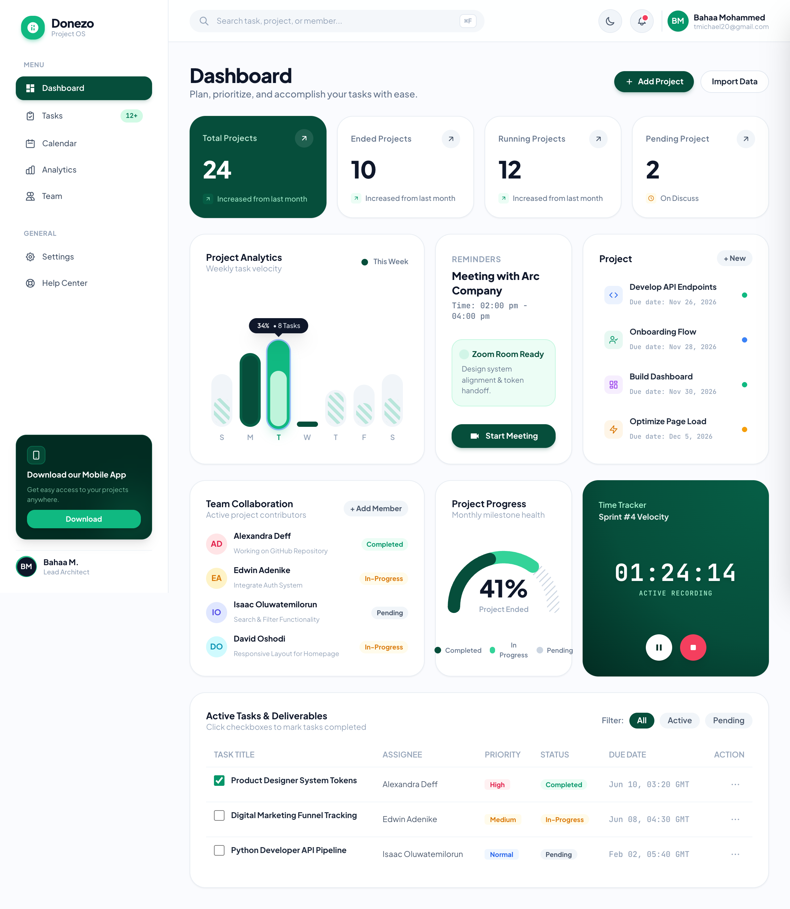
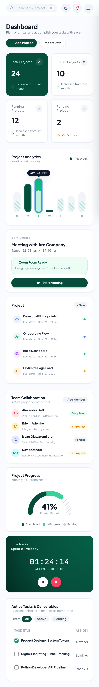
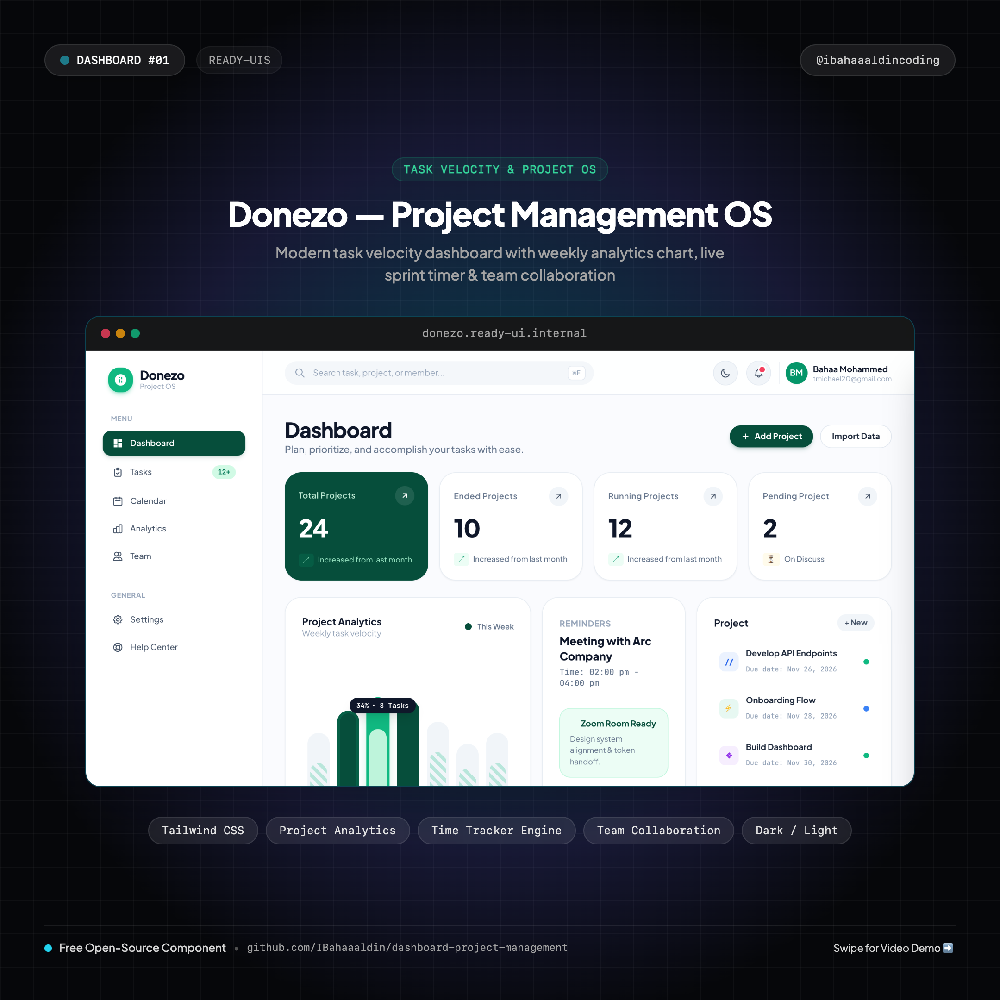
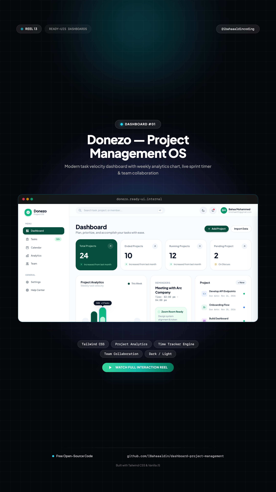

# 📊 Donezo — Modern Project & Task Management Dashboard

> High-craft Dribbble-style project management workspace featuring weekly task analytics chart, live sprint timer, team collaboration roster, and progress arc gauge.



[](https://IBahaaaldin.github.io/dashboard-project-management/)
[](https://IBahaaaldin.github.io/dashboard-project-management/)

---

## 🌐 Visual Previews

| Desktop Showcase (1200x900) | Mobile Showcase (390x844) | Post Cover (1080x1080) | Reel Cover (1080x1920) |
| :---: | :---: | :---: | :---: |
|  |  |  |  |

*(Includes full interaction videos: `video-desktop.mp4` and `video-mobile.mp4`)*

---

## ✨ Features & Micro-Interactions

- **Floating Dribbble-Style Presentation Canvas**: Sits inside a generous rounded container (`rounded-[32px]`) with soft diffused drop-shadows and dark/light outer background.
- **Persistent Left Navigation Sidebar**: Complete with "Donezo" logo, "MENU" items (Dashboard active pill, Tasks with `12+` badge, Calendar, Analytics, Team), "GENERAL" settings, bottom Mobile App promo card, and user profile badge.
- **Top Command & Search Header**: Search input with keyboard shortcut pill (`⌘F`), notifications bell with alert beacon, and creator profile pill.
- **4 Bento Key Metric Cards**: "Total Projects" (24, dark emerald highlighted card with arrow trigger), "Ended Projects" (10), "Running Projects" (12), and "Pending Project" (2, On Discuss).
- **Interactive Project Analytics Bar Chart**: Weekly bar velocity chart (Sun–Sat) with rounded dual-stripe pill bars and a floating tooltip bubble that tracks cursor hover (`34% • 8 Tasks`).
- **Meeting Reminders & Quick Join**: Upcoming "Meeting with Arc Company" card with an interactive "Start Meeting" button that triggers a live call state (`In Meeting (00:01)`).
- **Project Tasks Checklist**: Active deliverable list featuring custom category icons, due dates, and completion status dots.
- **Team Collaboration Roster**: Contributor cards with avatars, assigned micro-tasks, and colored status badges (`Completed`, `In-Progress`, `Pending`).
- **Project Progress Radial Arc Gauge**: SVG semi-circle gauge displaying `41% Project Ended` with dual-color fill and milestone legend.
- **Live Sprint Time Tracker**: Deep emerald textured widget with active digital clock (`01:24:08`), working Pause/Resume button, and Reset controls.
- **Active Deliverables Data Table**: Interactive task rows with functional checkboxes, priority tags (`High`, `Medium`, `Normal`), and status pills.
- **Web Audio API Sound Effects**: Embedded tactile sound synthesizers for meeting calls, timer toggles, and button taps (zero audio assets).
- **Daylight Clean ↔ Deep Obsidian Dark Mode**: Seamless toggle between crisp light minimalism and dark emerald void.
- **Zero Build Step**: Standalone HTML5, Tailwind CSS CDN, and vanilla ES6 JavaScript.

---

## 📁 Repository Structure

```text
├── index.html              # Standalone production dashboard component
├── cover.png               # Widescreen cover banner (2560x1280)
├── cover-instagram.png     # Square post cover for Instagram (@ibahaaaldincoding) (2160x2160)
├── cover-reel.png          # 9:16 vertical cover for Instagram Reels (2160x3840)
├── screenshot-desktop.png  # Desktop visual preview (2400x1800)
├── video-desktop.mp4       # Desktop interaction recording (1200x900 @ 30fps)
├── screenshot-mobile.png   # Mobile visual preview (780x1688)
├── video-mobile.mp4        # Mobile interaction recording (390x844 @ 30fps)
├── record.js               # Playwright automation script used to record all 4 assets
├── README.md               # Standardized documentation & setup notes
└── CAPTION.md              # Ready-to-copy Instagram caption for @ibahaaaldincoding
```

---

## 🚀 Quick Start

### 1. View Locally
Simply open `index.html` in your browser:
```bash
open index.html
```

### 2. Re-record Assets
To re-record desktop & mobile screenshots and videos:
```bash
node record.js
```

---

## 👤 Author & Connect

**Bahaa Mohammed**  
Creative Developer & Software Engineer
- 📸 **Instagram**: [@ibahaaaldincoding](https://www.instagram.com/ibahaaaldincoding)
- 🐙 **GitHub**: [@IBahaaaldin](https://github.com/IBahaaaldin)
- 💼 **LinkedIn**: [Bahaa Mohammed](https://www.linkedin.com/in/bahaa-mohammed-371259369)
- 📧 **Email**: bahaam.coding@gmail.com

---

## 📄 License

MIT © [Bahaa Mohammed](https://github.com/IBahaaaldin)
